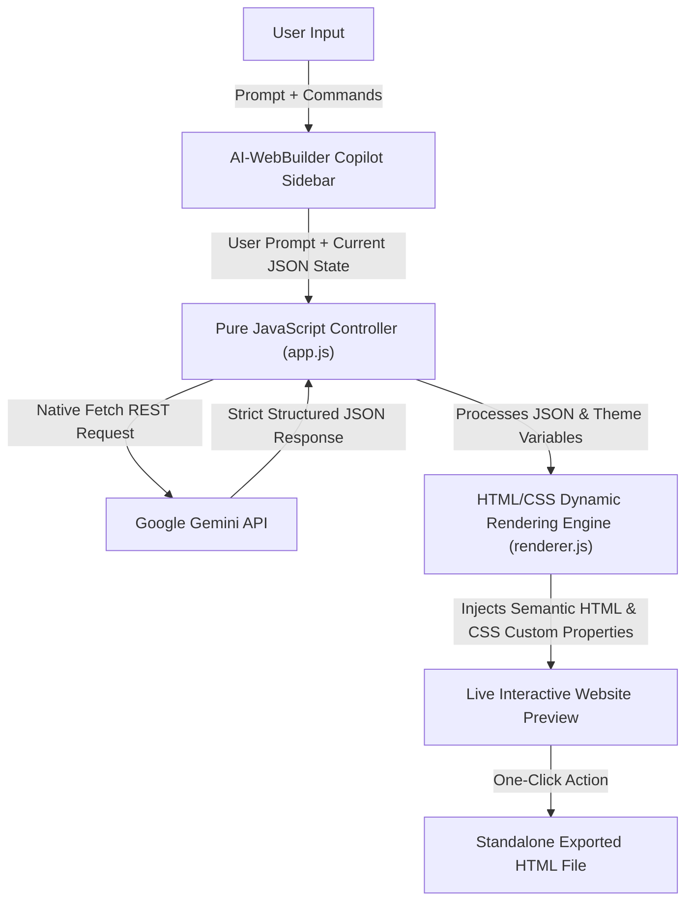

<div align="center">
  <h1>AI-WebBuilder 🚀</h1>
  <p><b>An intelligent Generative AI website copilot built purely with HTML5, CSS3, and Vanilla JavaScript.</b></p>
  
  
  
  
  
  
  
</div>

---

## 📖 Table of Contents
- [About the Project](#-about-the-project)
- [Key Features](#-key-features)
- [Architecture & Flowchart](#-architecture--flowchart)
- [Project Structure](#-project-structure)
- [Getting Started](#-getting-started)
- [Technical Highlights](#-technical-highlights)
- [License](#-license)

---

## 🚀 About the Project
**AI-WebBuilder** is a Generative AI-powered website builder that acts as a real-time copilot for web design. It empowers users to generate and iteratively refine custom, highly-visual website layouts simply by typing natural language prompts.

Under the hood, the application communicates directly with the **Google Gemini API** using native browser ES modules to translate conversational requests into structured JSON configurations. A custom **pure JavaScript rendering engine** dynamically parses these configurations and injects them into clean, semantic **HTML5 and CSS3** templates in real-time — with **zero frameworks, zero bundlers, and zero React**.

---

## 🌟 Key Features
- **Prompt-to-Website Engine:** Translates natural language prompts into complete, responsive website layouts in under 3 seconds.
- **Dynamic Theming System:** Instant live switching between 7 visual themes (Dark, Light, Brutalist, Purple, Editorial, Vibrant, and Warm) powered by CSS Custom Properties (`:root`).
- **10+ Modular Section Renderers:**
  - **Editorial Section:** Visual poetry paired with dynamic image generation via Pollinations AI keyword triggers.
  - **Magazine Grid:** Bold, numbered editorial categories and responsive content blocks.
  - **About & Services:** Glassmorphic cards with responsive CSS Grid layouts.
  - **Featured Projects:** High-impact showcase cards with smooth hover transitions.
  - **Testimonials:** Elegant quote styling with client attributions.
  - **Pricing Plans:** Multi-tier pricing tables with highlight scaling and feature checklists.
  - **FAQ Section:** Clean, high-legibility question-and-answer accordions.
  - **Call to Action (CTA):** High-converting visual banners.
  - **Stats Section:** Bold numerical metrics and performance counters.
- **Iterative Refinement (100% State Retention):** The state management pipeline feeds the active website configuration into the AI's chat context, allowing targeted section edits without losing existing work.
- **10 Preset Showcase Templates:** Instant one-click presets including Brutalist Studio, Minimalist Fashion, Neon Cyberpunk, Midnight SaaS, and Earthy Ceramics.
- **One-Click HTML Export:** Generates and downloads a production-ready, standalone `.html` file with all inline styling and fonts included.

---

## 🧠 Architecture & Flowchart



---

## 📁 Project Structure

```text
AI-webbuilder/
├── index.html          # Semantic HTML5 entry point & workspace
├── style.css           # Complete pure CSS design system & dynamic theme engine
├── js/
│   ├── app.js          # Core application controller & state manager
│   ├── renderer.js     # Pure HTML/CSS dynamic section rendering engine
│   ├── ai.js           # Native Google Gemini API integration (Fetch)
│   └── templates.js    # 10+ preset starting templates
├── .gitignore          # Git ignore configuration
├── LICENSE             # MIT License
└── README.md           # Project documentation
```

---

## 🛠️ Getting Started

### Zero-Setup Instant Run
Because this project is built entirely with pure web standards (**HTML5, CSS3, Vanilla JavaScript**), there are **no packages to install** and **no build commands to run**:

1. **Clone the repository:**
   ```bash
   git clone https://github.com/Santhosh-nakka/AI-webbuilder.git
   cd AI-webbuilder
   ```

2. **Open the application:**
   - Double-click `index.html` to open it directly in any modern web browser, **OR**
   - Serve using VS Code Live Server or Python:
     ```bash
     python -m http.server 3000
     ```

3. **Start Creating:**
   - Paste your [Google Gemini API Key](https://aistudio.google.com/app/apikey) into the sidebar.
   - Type a prompt or click one of the quick suggestions to generate your site!

---

## 💻 Technical Highlights
- **100% Pure Vanilla Stack:** No React, No Vite, No Tailwind, No node_modules.
- **CSS Custom Properties:** Dynamic live theme switching with zero page reloads.
- **Native Fetch REST API:** Uses browser-native `fetch()` to call the Google Gemini endpoint directly.
- **Secure Architecture:** API keys are stored solely in browser `localStorage` and never transmitted to external third-party servers.

---

## 📄 License
Distributed under the MIT License. See `LICENSE` for more information.
